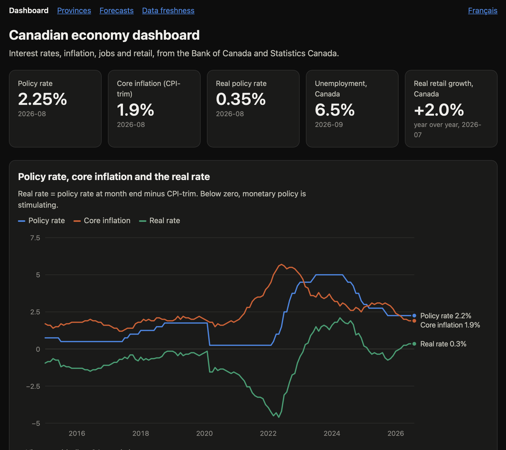
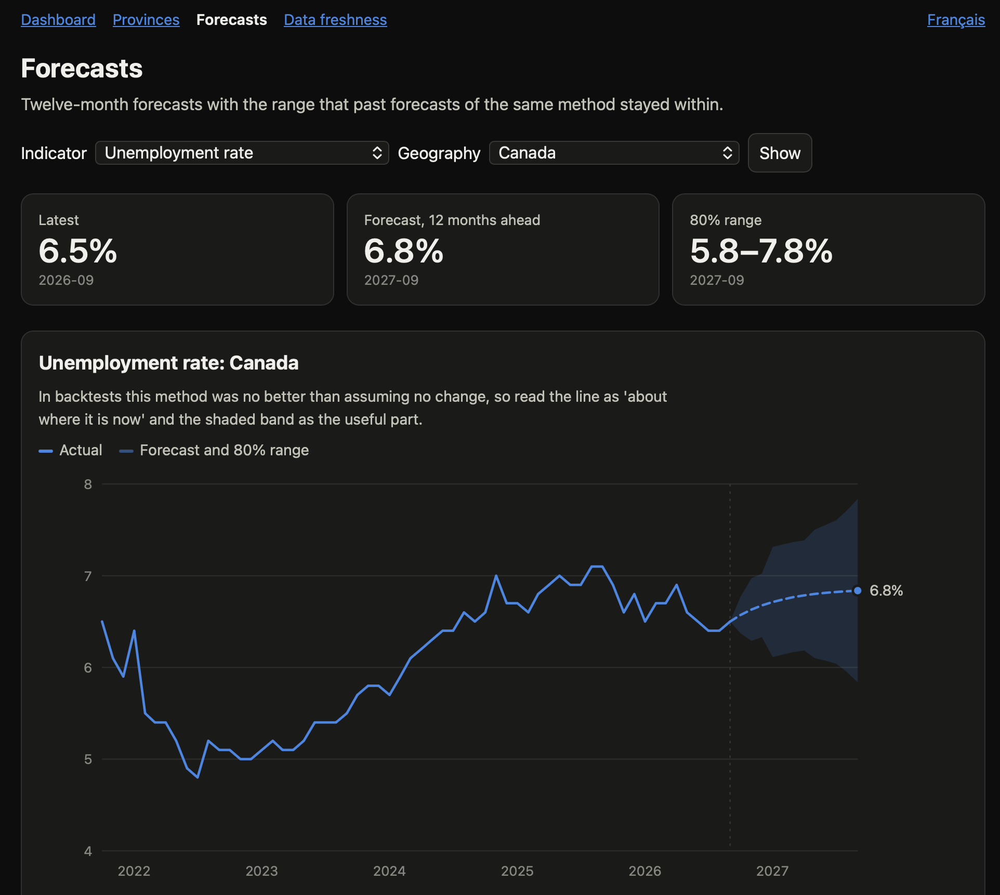
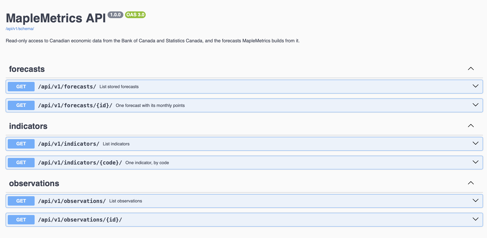

# MapleMetrics

[](https://github.com/omarfaruqe/maplemetrics/actions/workflows/ci.yml)

Canadian economic data, from ingestion to forecasts, in one Django project. MapleMetrics pulls
public data from the Bank of Canada and Statistics Canada into a PostgreSQL warehouse, turns it
into dashboards, forecasts a few key series with an honest account of how good those forecasts
are, and serves everything in English and French through a web interface and a REST API.

It is a portfolio project that covers three jobs end to end: **data engineering** (ingestion,
warehouse, freshness monitoring), **data analysis** (KPIs and dashboards) and **data science**
(backtested forecasting with empirical prediction ranges).



| Forecasts | API documentation |
|---|---|
|  |  |

## What it does

- **Ingests** five Bank of Canada series (exchange rate, policy rate, three inflation measures)
  and three Statistics Canada tables (unemployment, retail sales, consumer prices) for Canada and
  the ten provinces. Reruns are safe: values are upserted, so revisions are picked up.
- **Analyses** the data: the real policy rate, unemployment by province, real retail sales growth,
  and a province-against-Canada comparison. Charts are server-rendered SVG with light and dark
  themes and a table view for every chart.
- **Forecasts** unemployment, retail sales and the consumer price index twelve months ahead. Each
  forecast comes with an 80% range taken from past forecast errors, and the page says so plainly
  when a method is no better than assuming nothing changes.
- **Serves** a read-only REST API with OpenAPI documentation, paging, filtering, rate limiting and
  cache headers.
- **Speaks English and French**: the language follows the browser and can be switched on every
  page. Province names, number formats and chart tooltips follow the language too.
- **Is built to be accessible**: it targets WCAG 2.2 AA, with a skip link, keyboard-reachable
  charts and tables, a text description for every chart, and an automated axe-core audit in CI.
  See [Accessibility](docs/accessibility.md).
- **Is hardened and scanned**: a strict Content-Security-Policy with no scripts, `bandit` and
  `pip-audit` in CI, and Dependabot for dependencies. See [Security](docs/security.md).
- **Watches itself**: a freshness page and command flag any indicator whose data is stale.

## Quick start

You need Docker. Everything else runs in containers.

```bash
cp .env.example .env
docker compose up -d --build
docker compose run --rm --build refresh
```

The last command loads all the data and builds the forecasts. It downloads full Statistics Canada
tables and backtests about 33 series, so expect several minutes. Then open:

| Page | Address |
|---|---|
| Dashboard | http://localhost:8000/ |
| Provinces | http://localhost:8000/provinces/ |
| Forecasts | http://localhost:8000/forecasts/ |
| Data freshness | http://localhost:8000/freshness/ |
| API documentation | http://localhost:8000/api/v1/docs/ |
| Health check | http://localhost:8000/health/ |

`make up`, `make test`, `make lint`, `make fmt` and `make refresh` wrap the common commands.

## The API

Read-only, JSON, no key needed. The interactive documentation is at `/api/v1/docs/` and the
OpenAPI schema at `/api/v1/schema/`.

| Endpoint | Returns |
|---|---|
| `GET /api/v1/indicators/` | Every indicator with its observation count and date range |
| `GET /api/v1/indicators/{code}/` | One indicator |
| `GET /api/v1/observations/` | Observations, filtered by `indicator`, `geography`, `start`, `end`; paged with `page` and `page_size` (up to 1000) |
| `GET /api/v1/forecasts/` | Stored forecasts, filtered by `indicator` and `geography` |
| `GET /api/v1/forecasts/{id}/` | One forecast with its monthly points and ranges |

```bash
curl -s "http://localhost:8000/api/v1/observations/?indicator=LFS_UNEMPLOYMENT_RATE&geography=Quebec&start=2025-01-01"
curl -s -H "Accept-Language: fr" "http://localhost:8000/api/v1/indicators/RETAIL_SALES/"
```

Clients are limited to 120 requests per minute (`API_THROTTLE_RATE`), and successful responses
may be cached for five minutes (`API_CACHE_SECONDS`).

## Management commands

| Command | Purpose |
|---|---|
| `ingest_boc [--series CODE ...] [--start YYYY-MM-DD]` | Load Bank of Canada series, incrementally |
| `ingest_statcan [--measure CODE ...] [--inspect TABLE_ID]` | Load Statistics Canada tables; `--inspect` prints a table's columns |
| `run_forecasts [--indicator CODE] [--geography NAME]` | Build and store the current forecasts |
| `evaluate_forecasts INDICATOR [--geography NAME]` | Print a backtest leaderboard of all six methods |
| `freshness_report [--fail-if-stale]` | Print how recent each indicator is |
| `refresh_data [--skip-forecasts]` | Reload every source, then rebuild forecasts |
| `compile_translations [--check]` | Compile the French catalog; `--check` also reports missing translations |

Run any of them with `docker compose run --rm web python manage.py <command>`.

## Development

```bash
python -m venv .venv
source .venv/bin/activate
pip install -r requirements-dev.txt
pytest
ruff check . && ruff format --check .
make audit
```

Tests use in-memory SQLite unless `POSTGRES_HOST` is set; CI runs them against PostgreSQL 16 with
an 80% coverage gate. CI also lints, builds the Docker image and smoke-tests the running stack.
A test runs Django's `check --deploy` against the production settings. Another group of tests
checks accessibility rules (colour contrast, chart descriptions, table captions); a browser-based
axe-core audit runs in CI and can be run locally, see [Accessibility](docs/accessibility.md).

To add or change French text, edit `locale/fr/LC_MESSAGES/django.po` and run
`python manage.py compile_translations`. A test fails if a string in the code has no translation
or if the committed `.mo` file is out of date. GNU gettext is not needed.

## Layout

```
config/            Django project and split settings (base, dev, prod, test)
apps/core/         Health and freshness pages, language helpers, refresh and translation commands
apps/warehouse/    Indicator and Observation models, freshness report
apps/ingestion/    Bank of Canada and Statistics Canada clients, catalog, loaders
apps/analytics/    KPIs, SVG charts, dashboard and province pages
apps/forecasting/  Methods, backtest, stored forecasts, forecast page
apps/api/          REST API and OpenAPI documentation
locale/fr/         French translations
docs/              Architecture, data dictionary, forecasting methods
```

## Documentation

- [Architecture](docs/architecture.md): how the pieces fit together and why
- [Data dictionary](docs/data-dictionary.md): every source, indicator and table
- [Forecasting methods](docs/methods.md): how forecasts are built, scored and what they cannot do
- [Accessibility](docs/accessibility.md): the standard it targets, what is tested and the known gaps
- [Security](docs/security.md): what is in place, how it is checked and what is not covered

## Honest limits

- The forecasts use each series' own history only. They do not know about policy changes, shocks
  or other indicators, and they are not advice.
- Statistics Canada revises past values. Backtests run on the current, revised history, which is
  kinder than what a forecaster would have seen at the time.
- The 80% ranges describe how past forecasts of the same method behaved. They do not guarantee the
  next one will stay inside.
- Unemployment is hard to beat with a model: in the backtests on the data loaded for this project,
  the chosen method was about as good as assuming no change, and the page says so.

## Data sources and licences

- Statistics Canada tables 14-10-0287 (labour force), 20-10-0056 (retail trade) and 18-10-0004
  (consumer prices). Contains information licensed under the
  [Statistics Canada Open Licence](https://www.statcan.gc.ca/en/reference/licence).
- Bank of Canada [Valet API](https://www.bankofcanada.ca/valet/docs). Check the Bank's terms
  before redistributing its data.

Every page of the site carries the credit and licence notices these terms ask for, in English and
French (a test fails if a page loses them). Statistics Canada data is shown as adapted, since the
site derives real rates and forecasts from it. Bank of Canada logos and wordmarks are not used.

MapleMetrics is not affiliated with or endorsed by either organisation.

## Licence

[MIT](LICENSE). Version history is in the [changelog](CHANGELOG.md).
