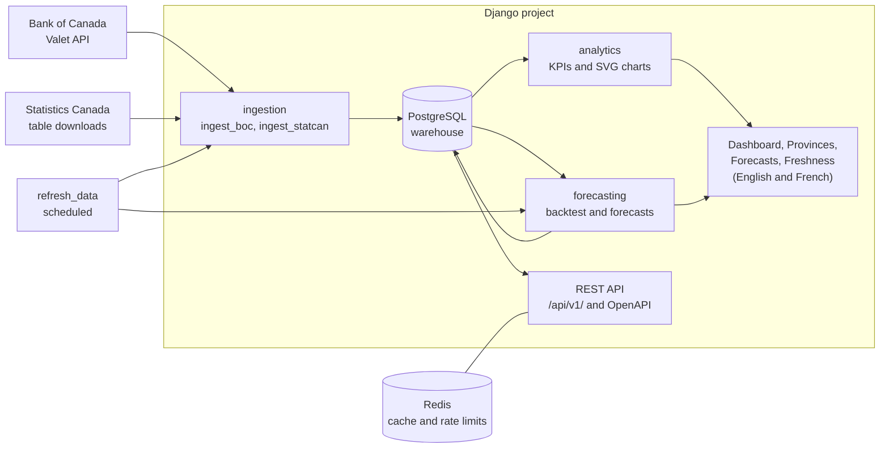

# Architecture

## The pieces

Three containers run in Docker Compose: `web` (Gunicorn serving Django), `db` (PostgreSQL 16) and
`redis` (cache and API rate-limit counters). A fourth service, `refresh`, only runs when asked
(`docker compose run --rm refresh`) and does the scheduled reload.

## Data flow

1. **Ingest.** Each source has a client that turns the raw response into plain points
   (`apps/ingestion`). Bank of Canada series come from the Valet JSON API and load incrementally
   from the latest stored date. Statistics Canada tables are downloaded whole, filtered to the
   dimension values listed in the catalog, and reloaded in full, because past values get revised.
2. **Store.** Loaders upsert into two tables, `Indicator` and `Observation`, in one transaction
   per measure. The unique key (indicator, geography, date) makes every run safe to repeat.
3. **Analyse.** `apps/analytics/kpis.py` reads observations and computes the derived figures
   (real policy rate, year-over-year changes, real retail growth). Views pass the results to
   templates; charts are drawn on the server as SVG strings.
4. **Forecast.** `run_forecasts` backtests the chosen method per series, fits it on the latest
   data, builds the range from the backtest errors and stores the result in `Forecast` and
   `ForecastPoint`. Pages and the API read the stored rows; nothing is fitted during a request.
5. **Serve.** HTML pages and the REST API read from the same tables.

## Decisions worth knowing

| Decision | Why |
|---|---|
| Server-rendered SVG charts, no JavaScript chart library | No front-end build, nothing to break, light and dark themes through CSS variables, and a table view for every chart |
| Forecasts computed ahead of time and stored | Pages stay fast and predictable; a request never runs a model |
| Empirical ranges from backtest errors | They reflect how this method actually erred on this series, with no distribution assumed |
| Statistics Canada tables reloaded in full | Revisions to seasonally adjusted data would be missed by an incremental load |
| Translation catalog compiled by a small Python tool | No need for GNU gettext on laptops, in Docker or in CI; a test keeps the compiled file honest |
| Settings split into base, dev, prod and test | Production refuses to start with the development secret; tests run on SQLite for speed or PostgreSQL in CI |
| Public API without keys, with rate limits and cache headers | The data is public and the API is read-only, so keys would add friction without adding safety |
| Static files served by WhiteNoise, collected when the image is built | The only static files are the admin's. The app serves them itself, hashed and compressed, so there is no extra web server to configure and the image works the same behind any proxy or URL prefix |

## Quality gates

- **Tests**: unit tests for parsers, methods and KPIs, and view and API tests against a test
  database. Coverage must stay above 80%.
- **Lint and format**: ruff, enforced in CI and by pre-commit.
- **Migrations**: CI fails if models changed without a migration.
- **Translations**: a test fails on any untranslated string or stale compiled catalog.
- **Deployment**: a test runs `check --deploy` on the production settings.
- **Smoke test**: CI builds the image, starts the full stack and waits for `/health/`.
- **Security**: `bandit` and `pip-audit` run in CI and weekly; tests check the Content-Security-Policy,
  that charts escape text, and that pages contain no scripts. See [Security](security.md).
- **Observability**: `/status/` and `/status.json` check the database, cache and refresh schedule;
  logs are JSON with a request id. See [Operations](operations.md).
