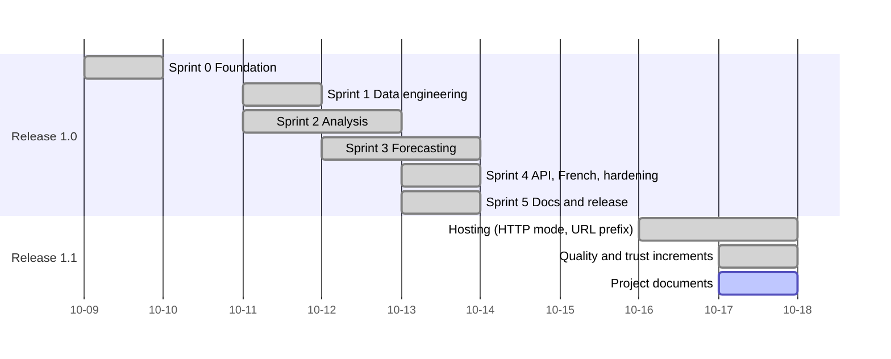

# Roadmap and backlog

Dates and commit ids come from the git history. "Evidence" is where to look to confirm a claim.

## Roadmap

## Delivered

### Release 1.0 (tag `v1.0.0`, 2026-10-13)

| Sprint | Goal | Delivered | Commits |
|---|---|---|---|
| 0 Foundation | A project that builds, tests and runs anywhere | Django project with split settings, Docker Compose (web, PostgreSQL, Redis), test setup, CI skeleton, CI badge | `742a389`, `3313232`, `439695a` |
| 1 Data engineering | Real data in a warehouse, safely re-loadable | Indicator and Observation models; Bank of Canada ingestion (5 series); Statistics Canada ingestion (3 tables, Canada and 10 provinces); idempotent upserts; freshness report command and page | `8c42341`, `dad6f53`, `abd32dc`, `78eb45d` |
| 2 Analysis | Turn data into insight | KPIs (real policy rate, unemployment by province, real retail growth); dashboard; province comparison; server-rendered SVG charts with table views | `878167a`, `d4120ec` |
| 3 Forecasting | Forecasts with honest reliability | Six methods behind one interface; rolling-origin backtest; stored 12-month forecasts with empirical 80% ranges; forecasts page with plain-language verdict | `8a2bbe7`, `37787b8`, `b949491` |
| 4 Platform | Usable by programs and by both official languages; production-ready | Read-only REST API with OpenAPI docs; French and English interface and translation tooling; rate limiting, caching, production settings, scheduled refresh command | `a6dca47`, `2ffc2a4`, `b8eb413` |
| 5 Documentation and release | Understandable and releasable | README with screenshots, architecture, data dictionary, forecasting methods, licence, changelog, `v1.0.0` tag | `5170cbe` |

### Release 1.1 (in progress, unreleased)

| Increment | Delivered | Commits |
|---|---|---|
| Hosting on a plain server | `DJANGO_HTTPS` switch for HTTP-only deployments; web port bound to localhost; serving under a URL prefix (`/maplemetrics/`) with unique cookie names | `fe7321e`, `67f5b10`, `bf4111a`, `4501bac` |
| Accessibility | WCAG 2.2 AA fixes, chart descriptions, captions, skip link, axe-core audit in CI | `3e9e3ec` |
| Data attribution | Licence and source footer in both languages, checked by tests | `3e23adb` |
| Security | Content-Security-Policy, `bandit`, `pip-audit`, Dependabot, updated Actions | `cf6b0a2` |
| Observability | `/status/` page and `/status.json`, structured JSON logs with request ids | `3e6b0e3` |
| Static files | WhiteNoise, build-time `collectstatic` | `9b6fbb5` |
| Project documents | This folder | (this commit) |

## Open backlog

Priority uses MoSCoW (Must, Should, Could). Effort is S (under an hour), M (a few hours), L (a day or more).

| ID | Item | Priority | Effort | Why it matters | Status |
|---|---|---|---|---|---|
| B-01 | Make the server reachable from the internet on port 80 and confirm the demo URL loads | Must | S | The charter's last success criterion; a live demo is the best proof of the project | Blocked: diagnostics from the server and from outside are needed |
| B-02 | Confirm the first full data refresh loaded and the status page reads "ok" | Must | S | Proves the pipeline works in production | Open |
| B-03 | Set up and verify the daily cron refresh and backup job on the server | Must | S | Without it the data goes stale and the status page warns | Open |
| B-04 | Restore runbook: restore a backup into a clean database and record the steps and time taken | Must | M | A backup that has never been restored is an assumption | Open |
| B-05 | HTTPS with a domain name and certificate | Should | M | Needed before anything beyond public data is hosted; settings already support it | Waiting on a domain |
| B-06 | Serve Swagger UI from the project (no CDN) and tighten the docs-page policy | Should | S | Removes the last outside dependency at runtime | Open |
| B-07 | Ingestion idempotency and revision tests against recorded real responses | Should | M | Protects the most important data-engineering promise | Open |
| B-08 | Query-count and response-time tests for the main pages | Should | M | Catches slow pages before users do | Open |
| B-09 | CSV download for any chart or table | Should | S | Most requested feature for an open-data tool | Open |
| B-10 | "How to read this" page: real rate, MASE, empirical ranges in plain language, in both languages | Should | M | The forecasting honesty is the project's differentiator; it should be explained | Open |
| B-11 | Forecast accuracy over time (compare past forecasts with what happened) | Could | L | Turns backtests into a live track record | Open |
| B-12 | Additional indicators (for example GDP, wages, housing) | Could | L | Broader value; each needs a catalog entry, tests and French names | Open |
| B-13 | Side-by-side comparison of two provinces | Could | M | Natural extension of the province page | Open |
| B-14 | Container image vulnerability scan in CI | Could | S | Dependabot updates the base image but the built image is not scanned | Open |
| B-15 | Usability test with screen-reader users | Could | M | Automated tools find only part of the problems | Open |
| B-16 | Demo GIF and a short video walkthrough for the README | Could | S | Faster to review than screenshots | Open |

## Prioritisation notes

- Items that prove the system works in operation (B-01 to B-04) come before new features,
  because an unverified deployment is a bigger risk than a missing feature.
- Trust items (B-04, B-05, B-07) come before reach items (B-09, B-12), in line with the project's
  theme of being honest about reliability.
- Items that were considered and left out are listed in the charter's out-of-scope section.
